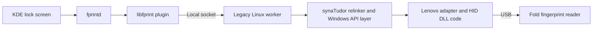
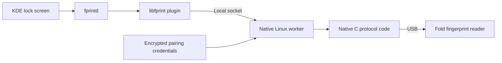
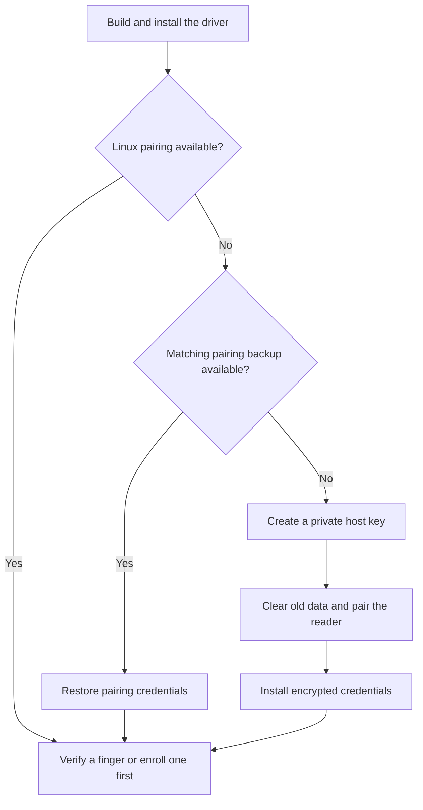

# Fingerprint unlock for the ThinkPad X1 Fold

This Linux driver lets `fprintd` and KDE use the fingerprint reader in the **ThinkPad X1 Fold 16 Gen 1** detachable keyboard. It targets USB `17ef:6142`, fingerprint HID interface 04.

The driver was tested on Ubuntu 26.04.1 x86-64. On one physical Fold, a right-index print enrolled and unlocked KDE. Verification also worked after USB reconnect, suspend, and reboot. [Test details](docs/native-backend.md)

## The earlier synaTudor approach

[synaTudor](https://github.com/Popax21/synaTudor) makes Synaptics Windows fingerprint drivers usable on Linux. It runs the vendor's driver logic instead of replacing it. The [06cb:00fd port](https://github.com/Manasi-ish/synaptics-06cb-00fd-linux) is one example for a **different reader**. This Fold project also used synaTudor in an [earlier worker](https://github.com/Caesurus/thinkpad-x1-fold-fingerprint/blob/5b204212cb0f608acdbf476ac00b9ef4356cb704/vendor-host/build_worker.py). Its build took pinned synaTudor C sources and extracted Lenovo's `synaFpAdapter153.dll` and `synaWudfBioHid153.dll` from the Fold driver package. It embedded the DLLs in a Linux executable.

At unlock time, that executable ran the Windows driver code through synaTudor's relinker. Its compatibility layer supplied the Windows and WDF functions the DLLs expected. The driver code then talked to the Fold reader. The diagram shows the logical path; the relinker and DLL code lived inside the legacy worker.



That approach made the reader usable and gave this project a working reference. It also required the synaTudor source checkout and Lenovo's proprietary DLLs to build, and it executed those DLLs for each fingerprint operation.

## The native approach here

Both designs use a Linux worker. In this one, C code in this repository handles the Fold's pairing, encrypted connection, enrollment, matching, and deletion. That code is compiled into the worker. A separate native setup tool uses it for first-time pairing. Neither tool loads a Windows DLL.



The main improvement is a smaller dependency chain. The normal build needs this repository and Linux development packages; it no longer needs a synaTudor checkout or the Lenovo driver package. The runtime avoids Windows API emulation, and its protocol code can be tested and reviewed here. `make check-dll` can still compare against extracted DLLs offline, but installation and unlock do not use them. Hardware support remains focused on this Fold.

## Set up

[Install the build packages](docs/install-and-recovery.md#build-and-test), then run these commands from the repository directory:

```sh
make
make check
sudo ./install.sh
```

If this installation is already paired, you can verify an enrolled finger. If you reinstalled Linux and have a backup of the reader’s current pairing, restore it to keep your enrolled fingerprints. [Pairing recovery guide](docs/install-and-recovery.md#preserve-pairing-for-recovery)

If you have neither a working pairing nor a matching backup, first-time pairing clears the reader’s previous pairing and enrolled fingerprints, including Windows Hello. [First-time pairing guide](docs/install-and-recovery.md#first-time-pairing)



Once paired, enroll a finger if needed, then verify it:

```sh
fprintd-enroll -f right-index-finger
fprintd-verify -f right-index-finger
```

First-time setup uses fixed issuer data recovered from Lenovo's Fold v153 DLL. Each owner creates a **new private host key**, while the issuer data is shared. The native request was accepted by the tested Fold; a fresh reset and pairing on another physical Fold has not yet been tested.

The installed service receives the host key and certificates through systemd credentials. [Architecture and protocol notes](docs/native-backend.md)

To restore the previous driver files, run `sudo ./install.sh --rollback`. Rollback leaves sensor prints and pairing credentials in place. [Recovery steps](docs/install-and-recovery.md#roll-back-an-installation)

Source is licensed under LGPL 2.1 or later; see [LICENSES](LICENSES). Firmware update support is outside this driver.
