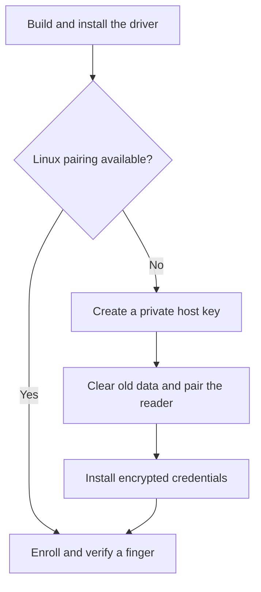
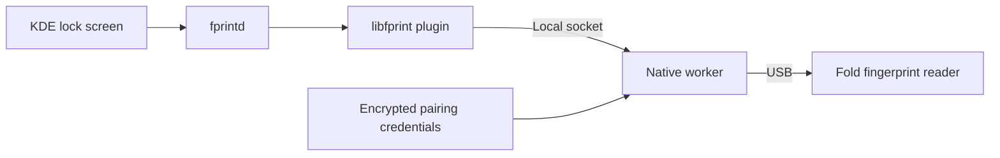

# Fingerprint unlock for the ThinkPad X1 Fold

This native Linux driver lets `fprintd` and KDE use the fingerprint reader in the **ThinkPad X1 Fold 16 Gen 1** detachable keyboard. It targets USB `17ef:6142`, fingerprint HID interface 04. Setup and daily use run without Windows DLLs or synaTudor.

The driver was tested on Ubuntu 26.04.1 x86-64. On one physical Fold, a right-index print enrolled and unlocked KDE. Verification also worked after USB reconnect, suspend, and reboot. [Test details](docs/native-backend.md)

## Set up

[Install the build packages](docs/install-and-recovery.md#build-and-test), then run these commands from the repository directory:

```sh
make
make check
sudo ./install.sh
```

If this Linux installation has no pairing credentials, follow the [first-time pairing guide](docs/install-and-recovery.md#first-time-pairing) before enrolling. That procedure clears the reader's saved pairing and fingerprints, including Windows Hello.



Once paired, enroll and test a finger:

```sh
fprintd-enroll -f right-index-finger
fprintd-verify -f right-index-finger
```

First-time setup uses fixed issuer data recovered from Lenovo's Fold v153 DLL. Each owner creates a **new private host key**, while the issuer data is shared. The native request was accepted by the tested Fold; a fresh reset and pairing on another physical Fold has not yet been tested.

## How unlock works



A separate native setup tool handles pairing. The worker handles secure sessions, enrollment, matching, and print deletion in C. The installed service receives the host key and certificates through systemd credentials. [Architecture and protocol notes](docs/native-backend.md)

To restore the previous driver files, run `sudo ./install.sh --rollback`. Rollback leaves sensor prints and pairing credentials in place. [Recovery steps](docs/install-and-recovery.md#roll-back-an-installation)

Source is licensed under LGPL 2.1 or later; see [LICENSES](LICENSES). Firmware update support is outside this driver.
