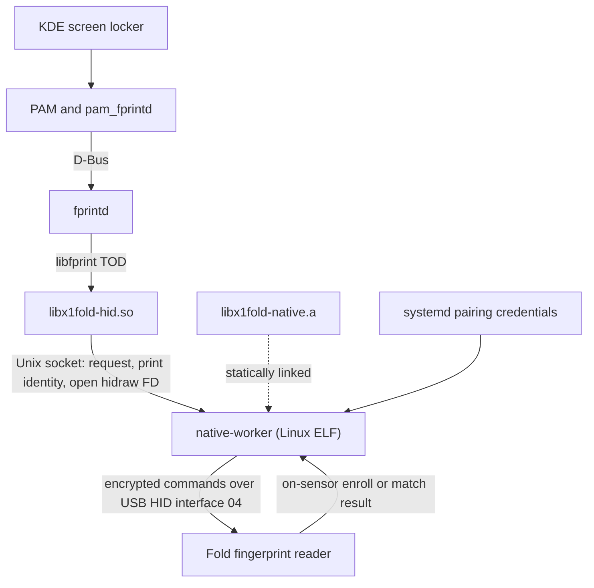
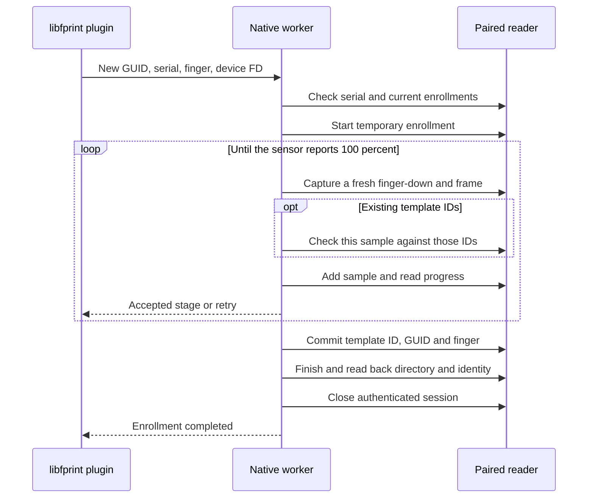

# Native Fold fingerprint backend

The target is the USB-connected ThinkPad X1 Fold 16 Gen 1 keyboard, USB `17ef:6142`, vendor HID interface 04. The reference driver is Lenovo N3LGF05W, with `synaFpAdapter153.dll` and `synaWudfBioHid153.dll`. The keyboard presents its own HID transport. Other Synaptics USB readers can use different transport and pairing policies.

## Build the native components

```sh
make native native-inspect native-worker native-register
make check
```

`make native` produces `build/libx1fold-native.a`. It needs Linux HID headers, GLib/GIO development files, OpenSSL 3 headers and a C toolchain. Consumers using certificates or encrypted sessions link libcrypto. The session integration tests use Python cryptography as an independent peer. The native diagnostic accepts an inherited reader descriptor and reports public firmware metadata when the session is idle. The native targets build offline with both Windows inputs absent. The default build and installer on this branch select the native worker. The legacy implementation has its own explicit build and installation options.

The native worker tests start a separate process at the point where the broker has validated the request and transferred the two descriptors. A software reader and ephemeral test credentials exercise the production credential loading, encrypted exchange, cancellation thread and private reply channel. The tests check the exact sequence of messages for enrollment, verification, deletion, a duplicate and a missing credential. An invalid close acknowledgement suppresses a match. A client cancellation while waiting for a finger ends the capture and closes the session. The production binary uses the standard broker and sensor trust checks.

On cancellation or timeout, the libfprint plugin closes the sending half of its worker socket. It discards late replies while the worker finishes with the reader. The worker releases its HID descriptor before closing the socket. At that point libfprint can complete cancellation and accept another scan. A ten-second timeout also releases the client if cleanup stalls. A libfprint regression test held the peer open, sent late progress and enrollment results, then closed it. The next simulated enrollment completed on the same open device. Physical cancellation followed by an immediate rescan still needs a working native pairing.

On 2026-11-18 the native backend replaced the legacy worker on the Fold. The installed executable matched the native build, the socket was enabled and listening, and fprintd discovered the physical reader and listed the existing right-index enrollment. A live verification request activated the native service. Systemd reported that all three native pairing credentials were absent. The native worker returned an error before capture. While fprintd held the reader claim, the unprivileged native diagnostic read firmware 10.1 build 3654703, product 0x41, interface 0x03, provisioning state 3 and security flags 0xa10b directly over HID. A metadata-only inventory of the retired system worker’s record directory found zero nonempty regular files at the level used by its host record store. This verifies physical native discovery and the installed route through fprintd and systemd. A physical native match and rejection still require a usable pairing.

| Operation | Native branch | Evidence and outstanding work |
| --- | --- | --- |
| Device identity, firmware metadata, session status | Implemented in C | The native diagnostic read the physical Fold’s firmware profile during an exclusive fprintd claim. The TOD entry point uses the same transport to read the serial. Mock tests exercise the actual plugin and active, idle and malformed HID feature replies. |
| Long commands and replies | Implemented in C | Packet-socket tests exercise report and fragment boundaries, event interleaving, cancellation, timeout and oversize responses. Synchronous metadata queries skip notifications. The secure session remembers notifications received during commands so capture can drain the reader’s event queue. |
| Verify the sensor certificate | Implemented for the advanced-security product 0x41, firmware 10.1 profile | Verifies the ECDSA/SHA-256 issuer signature and validates the P-256 subject point. Passed on a published certificate from a related 06cb:00ff reader. The Fold certificate and proof of the live peer remain unverified by this code. |
| Reuse an existing pairing | Native HOST directory and pairing-record validation demonstrated on the physical Fold. Full on-reader restore demonstrated by the OEM worker | A fresh OEM worker previously read HOST and opened an authenticated session with writes, formatting and new pairing disabled. The format and authorized use of the host credential still need to be established for the native worker. |
| Fresh pairing, ownership and key changes | Native C constructs and signs a host request locally and implements advanced registration | The Fold paired through the OEM driver. A related reader's recorded request validates the native encoding. An independent signature check uses a test issuer. Physical acceptance of a native request remains open. |
| Secure session and authenticated commands | Full native exchange, two commands and close tested against an independent software peer | Physical acceptance of this profile, retrieval of an authorized Fold pairing and a subsequent cold reconnect remain outstanding. |
| Frame capture | Native acquisition, encrypted event queue and finish tested against a software peer | Validate the enrollment and verification capture parameters on the Fold. Frame-ready establishes that a sample is available to the next biometric operation. |
| Verify an existing enrollment | Native worker and scoped on-sensor match implemented | Software peer tests cover a match, rejection and identity mismatches. Validate the quality policy, record layout and results against a physical Fold. |
| Enrollment | Native multi-touch acquisition, duplicate checks, commit and identity readback | Tested against an independent software reader with existing records and an empty directory. The Fold's duplicate-check behavior, capture cadence and actual write/readback need physical validation. |
| Record query and individual deletion | Native lookup, template deletion and readback implemented | Software peer tests cover deletion with another enrollment present, an absent print, ambiguous records and inconsistent readback. Physical deletion needs a separate disposable enrollment. |
| Firmware, configuration, diagnostics | Public firmware query only | The Fold DLL carries a signed main firmware update older than the measured build 3654703. Package applicability, update and recovery are separate from the authentication path. No native update was attempted. |

## Port review, November 19

The authentication port replaces the WinBio interface with libfprint and carries out sensor commands in the native worker. A fresh Ghidra decompilation of the v153 adapter covered capture start, verify, enrollment update and record deletion. In the HID image it covered session startup, capture cleanup, match-reply decoding and the image-quality threshold. The review sampled these eight functions against the broader call map below. It did not establish whole-image equivalence.

| Priority | DLL responsibility and Linux implementation | Remaining acceptance test or implementation |
| --- | --- | --- |
| 1 | The HID DLL restores pairing for a previously owned reader. The native worker loads two certificates and the matching host key from systemd. | Establish how to use the Fold's existing owner pairing from native code, then complete an authenticated firmware query, clean close and cold reconnect on this keyboard. The earlier OEM-only restore is the reference result. |
| 1 | For a fresh owner, the HID DLL prepares and signs the host request locally. Native code builds the request, submits advanced pairing and validates the returned certificates when supplied an issuing credential. | Determine the source and selection of the issuer used by this Fold. Demonstrate that a native request is accepted and that the resulting host identity reconnects. Existing-owner restore and fresh provisioning require separate proofs. |
| 2 | The adapter submits capture and verification to the HID driver. Native code acquires a frame, checks quality, asks the reader to match one template and validates the returned account and finger. | Verify a right-index match, wrong-finger rejection, cancel and subsequent scan through fprintd. Confirm the active reader quality policy. Native code currently uses the DLL default of 50. |
| 2 | Native enrollment collects samples, checks for a duplicate, commits and checks the stored identity. Deletion targets one template and checks the remaining directory. | Exercise retry, duplicate detection, enrollment readback and individual deletion with a disposable enrollment on the Fold. |
| 3 | The HID DLL also handles firmware and configuration updates and device management. The native implementation reads firmware metadata. | The signed updater and recovery remain separate maintenance work. The earlier OEM unlocks ran on the installed firmware. |

One match-reply difference was fixed in this review. In the HID DLL at RVA `0xa48f0`, a positive match can carry two variable-length fields after 36 bytes of statistics. The DLL consumes the first field before reading the second. The previous native parser required the first length to be zero. Verification and enrollment's duplicate check now validate both lengths. Verification reads identity metadata from the second field and still requires the expected template, account and finger. Tests include a nonempty first field, a mismatched account and an oversized field length. Whether this Fold emits a nonempty first field remains a hardware question.

## Offline DLL differential tests

Run from the repository root with the normal native build dependencies, Python `cryptography`, `pefile` and Unicorn 2.x. Supply the directory containing the two extracted Lenovo v153 DLLs. The test verifies each image's SHA-256 before executing its x86-64 instructions in Unicorn. Fixtures provide the Windows call frame, small guest heap, synthetic records and transport responses. The comparison invokes the built native registration tool, HOST reader and worker against the same inputs.

```sh
make check-dll DLL_DIR='/path/to/extracted/package'
```

| Compared behavior | What the test observes | Test boundary |
| --- | --- | --- |
| Prepare a host certificate | For three synthetic P-256 host keys, compare all 142 bytes assembled by the HID DLL with the signed body emitted by `native-register request`. Independently verify the native signature over the DLL bytes with an ephemeral issuer. | DLL execution stops exactly at the call to sign. This checks the bytes presented for signing. OEM issuer selection and certificate acceptance remain open. |
| Submit a host certificate for advanced pairing | Pass each of the three native requests to the HID DLL's PAIR routine. At its transport boundary, check the opcode, all 400 certificate bytes and the 802-byte response capacity. Exercise success and refusal for each key. | A simulated transport supplies distinct host and sensor record markers. The DLL copies both records in order on success and leaves the destination untouched on refusal. Reader acceptance and OEM signing are outside this check. |
| Validate and look up the HOST record | Feed the same 4 KiB image to the HID DLL's validator and tag lookup and to the native storage command. Compare present, absent and checksum-error results across eight images, including an exact-fit record, a corrupt trailing tag and an empty unknown tag. | The DLL calls a SHA-256 test service. Its record iteration, checksum comparison and tag lookup execute from the binary. Pairing data is opaque synthetic content. |
| Apply the default quality threshold and report a match | Compare seven worker outcomes with the HID DLL's threshold routine and, for accepted frames, run its match command against the identical binary sensor reply. Check the returned template, auxiliary bytes, identity and score. Pass the comparison flag to the adapter DLL's WinBio verification wrapper and compare its verdict with the worker's IPC event. | The configuration lookup returns an unset threshold. Sensor I/O and the adapter's underlying comparison callback are supplied by the test. The reader's physical finger comparison is outside this test. |

Three further cases check Linux identity binding. Each synthetic reply has a positive score and a different finger, account or template. The auxiliary field carries the expected identity. The HID DLL returns the identity and auxiliary fields separately, and the native worker must report no match in all three cases.

As a regression check, the pre-fix native worker at `147a88f` returned a worker error on the valid reply carrying a nonempty auxiliary field. Both vendor DLL routines yielded a match, as did the native worker with the fix at `56de78d`. The optional test dependencies and proprietary images are used only by `make check-dll`.

## Pairing credentials and the hardware test

In the Fold v153 HID DLL, `tudorSecurityDoPair` generates the host key pair and prepares the public host certificate before selecting basic or advanced pairing. A static trace from `_tudorSecurityPreparePairingParams` through two direct calls reaches a helper that calls `BCryptImportKeyPair`, `BCryptSignHash` and `BCryptDestroyKey` in that order. The import writes its output handle to a stack slot. The signing and destruction calls both read their key handle from that same slot. This identifies the signer as a key the driver supplies to Windows in memory. The trace establishes the handle's lifetime. The origin of the imported issuer credential on this Fold remains unverified. [Windows key import](https://learn.microsoft.com/en-us/windows/win32/api/bcrypt/nf-bcrypt-bcryptimportkeypair) · [Windows signing API](https://learn.microsoft.com/en-us/windows/win32/api/bcrypt/nf-bcrypt-bcryptsignhash)

The host key identifies the installation on later reconnects. On related hardware, recorded requests from three different host keys all verify under a single separate issuer, as detailed below. Identifying that issuer on the related reader does not establish which issuer this Fold accepts.

`x1fold_create_host_request` implements the local construction and signing step in C. It encodes the host P-256 public coordinates, signs the first 142 bytes with an OpenSSL issuing key and returns the 400-byte request. Given the public host point from the recording below, the native constructor reproduces all 142 signed bytes. The CLI regression test independently checks the resulting DER ECDSA/SHA-256 signature with a local test issuer and checks the remaining padding. Reader acceptance is a separate hardware test.

`make native-register` builds an optional administrative command. Its `request ISSUER-URI NEW-REQUEST` mode reads the host private key from protected fd 4, signs using the selected local OpenSSL provider and creates a new file with owner-only permissions. This mode runs with the reader disconnected. Its `register READER-SERIAL ISSUER-URI NEW-RESPONSE` mode additionally requires an unprivileged process with the exclusively claimed reader on fd 3. Use `native-inspect --serial` under the reader claim to obtain the twelve hexadecimal digits in firmware byte order and persist the host private key before registration.

For registration the library checks the request signature, confirms that the host key can sign, then checks the reader's identity, session status and firmware profile. The command sends one request and distinguishes refusal from an uncertain outcome. After acceptance it validates the returned host coordinates and sensor issuer signature. It saves both public records in a new 802-byte file with a two-byte zero completion marker followed by the host and sensor certificates in that order. An incomplete result starts with `ffff` once space has been reserved. A successful authenticated reconnect using the same host key is the proof that these credentials work. Normal fprintd transactions only use an existing pairing.

The observed firmware reports provisioning state 3 on an owned Fold. The outstanding hardware question is how the normal local path selects and authorizes a host identity for this reader. A native reconnect using an owner-held, usable previous pairing would also establish the session.

The original Fold run on November 18 records two distinct operations. At 19:03 UTC the stock driver formatted SSFS (partition 1) and HOST (partition 2). Both format replies had status zero. The subsequent pairing command returned status zero and 802 bytes, and the worker reached WinBio ready with TLS active. At 19:13 UTC a fresh worker read HOST and received 4,104 bytes including the reply header. That worker stopped any format, storage write or fresh pairing command before transfer. It reached WinBio ready with TLS active after the cold reconnect. The diagnostic counted zero nonempty saved user pairing records.

Linux supplied a random 32-byte service credential named `x1fold-dpapi` to both workers for their local data-protection shim. The host key pair was generated through the stock driver. The logs establish that the second worker could reuse the accepted pairing. They contain neither a saved host private key for the native worker nor evidence that formatting changed the reader's certificate issuer.

The v153 HID DLL has two data-protection paths. Ghidra shows that the normal pairing save and TLS restore callers pass a non-null fourth argument to `palSecureWrap` and `palSecureUnwrap` on both the sizing and output calls. That selects `palCryptoEncryptAndSign` on save and `palCryptoVerifyAndDecrypt` on restore. The null-argument branches lead to Windows `CryptProtectData` and `CryptUnprotectData`, which the compatibility worker implements using `x1fold-dpapi`. The earlier call graph showed reachability across both branches. The caller arguments establish which branch these routines select. A Linux DPAPI header check cannot establish how to restore the stock HOST record. The identity and scope of the driver's protection keys remain unverified.

Ghidra traces the cold-reconnect data flow more precisely. After opening HOST, `_tudorHostPartitionPairingInfoGet` requests tag 2 and places the result in the device context. The pairing-presence check tests that result, and `tudorSecurityGetPairingData` passes the same buffer descriptor to its unwrap helper during TLS initialization. The HOST open routine looks up partition 2 in the storage directory. Its validator walks 16-bit tag and length fields, 32-byte digests and value bytes, stopping at tag `0xffff` or the partition boundary. The version tag is 1. This establishes which logical record feeds reconnect. The tag lookup copies the stored value into the device context. TLS initialization passes that value to the driver-managed unwrap path described above.

With the same exclusive descriptor on fd 3 used by the firmware diagnostic, `native-inspect --host-storage` checks an idle Fold 10.1 reader's storage directory and reads the 4 KiB HOST partition. It validates the record lengths, SHA-256 checksums, version and pairing-tag presence in memory. It prints only whether a record is present, clears its reply buffer and performs no writes to the partition. The result checks storage consistency. An authenticated TLS reconnect still requires usable owner credentials. On November 19, 2026, the native diagnostic ran under an exclusive fprintd claim on the physical Fold. It reported a checksum-verified pairing record, firmware 10.1 build 3654703, provisioning state 3 and advanced pairing. This read left the existing record intact. A regression test also checks that the paired diagnostic sends an authenticated close after a malformed firmware reply and preserves the original query error.

The Fold v153 HID DLL's advanced pairing path sends command `0x93` with a 400-byte public host certificate. At RVA 0x9019c it reserves 401 bytes for the request. At 0x901f0 it expects an 802-byte reply, and at 0x9028e it copies the 800 bytes after the status. This establishes the exchange format on this driver. The Fold's measured firmware flags select this advanced branch. During initialization the DLL tests bit 0 of the first GET_VERSION security byte at RVA 0x78cc2 and sets a Boolean. It copies the Boolean into its device-information record at 0x78d1f. The 112-byte copy at 0x793b5 places it at device-context offset 0x1c. At 0x8f516 the pairing manager reads that byte and selects advanced pairing when it is nonzero. The physical Fold returned 0xa10b, whose low bit is set. This identifies the branch from the running firmware configuration. The original pairing on this individual keyboard has no corresponding packet recording.

A published recording from a related reader shows both sides of that exchange. In `finger2.pcapng` frame 241 the host sends a role-0 certificate with a 70-byte DER signature. The reply spans frames 244 and 246. The returned host record has the same 136 bytes of public coordinates, role 2 and a 32-byte field at the signature location. The other record contains the signed sensor certificate. The host private key stays with its owner. A saved USB exchange alone therefore cannot provide the key that signs a new session. [Public packet recording](https://github.com/vojtapl/synaTudorMiS/tree/5b3aecb3432b67083beeabdc1cfb0718513a83dd/reverse%20engineering/SP141455/Wireshark%20usb%20log)

Windows provides an administrator-only biometric maintenance API for vendor-defined operations. The Fold adapter exposes privileged sensor and storage handlers at RVAs 0x7b10 and 0xcdb0. Its privileged engine handler at 0x4550 returns `E_NOTIMPL`. The available evidence has not identified an owner-facing pairing export through those handlers. [Microsoft WinBio maintenance API](https://learn.microsoft.com/windows/win32/api/winbio/nf-winbio-winbiocontrolunitprivileged)

### Evidence for a persistent pairing issuer

The SP141455 USB recording and two Windows debug logs after separate fingerprint-data resets contain three distinct signed host requests with three different host public keys. For each outbound 401-byte PAIR message, the 142-byte certificate body and DER signature determine candidate ECDSA verification keys. Exactly one public key verifies all three requests. Its SHA-256 fingerprint over DER SubjectPublicKeyInfo is `a11d6ebce4a13c3bbf03653be9ea1ed1de24291309f2ba7c4c580b8a89e3e0f6`. OpenSSL independently verified each signature with that public key and rejected a one-byte change to each signed body. Thus the issuer persisted across those host-key changes on the related platform. The tested contiguous public-point encodings and SPKI were absent from the two Fold DLLs. The Fold issuer remains unidentified. [First reset, outbound request](https://github.com/vojtapl/synaTudorMiS/blob/5b3aecb3432b67083beeabdc1cfb0718513a83dd/reverse%20engineering/SP141455/WinDbg%20logs/logs%20after%20BIOS%20reset%20of%20fingerprint%20data/1/log%20detailed%20from%20bios%20fingerprint%20data%20reset#L13426) · [Second reset, outbound request](https://github.com/vojtapl/synaTudorMiS/blob/5b3aecb3432b67083beeabdc1cfb0718513a83dd/reverse%20engineering/SP141455/WinDbg%20logs/logs%20after%20BIOS%20reset%20of%20fingerprint%20data/2/log%20from%20start%20with%20extra%20symbols#L13324) · [USB recording](https://github.com/vojtapl/synaTudorMiS/tree/5b3aecb3432b67083beeabdc1cfb0718513a83dd/reverse%20engineering/SP141455/Wireshark%20usb%20log)

### Installing a completed native pairing

After the reader accepts registration, `native-register service-config` reads the saved 802-byte result and its host private key on fd 4. Supply the firmware security flags measured for that reader as hexadecimal digits. It checks the completion status, host public coordinates and signed sensor certificate for firmware 10.1, product 0x41. It then uses `systemd-creds` to encrypt the three named credentials for this machine and outputs one service drop-in. The running worker still verifies the live sensor during the handshake. A saved response alone cannot establish that the reader retained the pairing.

For the Fold that reported `a10b`, run the following in an administrative shell with the built tool, saved response and matching host key. This publishes the three credentials together and reloads the service template for the next transaction.

```sh
(
    set -eu
    umask 077
    dir=/etc/systemd/system/x1fold-fingerprint@.service.d
    mkdir -p "$dir"
    config=$(mktemp "$dir/.pairing-XXXXXXXX")
    trap 'rm -f -- "$config"' EXIT
    ./build/native-register service-config a10b /path/to/saved-response \
        4</path/to/owner-key.pem >"$config"
    mv -T -- "$config" "$dir/50-pairing.conf"
    systemctl daemon-reload
)
```

An optional integration test uses a temporary owner key, a public sensor certificate from the recording and an isolated user service. It verifies that systemd delivers both certificates and the owner key under the worker's exact credential names. Run `python3 native/test-register.py build/native-register /path/to/public-sensor-certificate.bin` from a desktop session. The `--user` encryption scope used by this test is specific to the user service.

## DLL call paths

RVAs below refer to the Fold v153 PE images. The package and file SHA-256 values are recorded in the repository's worker builder. Names for internal HID functions come from diagnostic string references matched to PE function bounds. Windows device-control numbers identify requests between the two DLLs. The on-wire HID commands are a separate protocol.

| Image | Entry or path | Evidence |
| --- | --- | --- |
| Adapter | `WbioQueryEngineInterface` 0x5980, `WbioQuerySensorInterface` 0xa2f0, `WbioQueryStorageInterface` 0xe5f0 | Return interface tables at 0x29020, 0x29190 and 0x292b0 respectively. |
| Adapter | StartCapture 0x6990, FinishCapture 0x6f50, PushDataToEngine 0x7500 | StartCapture submits Windows device control 0x440014. |
| Adapter | AcceptSampleData 0x25c0, VerifyFeatureSet 0x28d0, IdentifyFeatureSet 0x2b10 | VerifyFeatureSet calls helper 0x1150, which requests device control 0x442058 with input length 0x1088 and output capacity 0x18ac. This establishes where to follow a verification request. It does not establish the match algorithm or response field. |
| Adapter | UpdateEnrollment 0x30d0, CheckForDuplicate 0x3820, CommitEnrollment 0x3b20 | Distinct engine callbacks for updating, checking and committing the enrollment. |
| Adapter | DeleteRecord 0xbc60, QueryBySubject 0xc1e0, GetRecordCount 0xc6d0 | Storage callbacks used to address and manage records. |
| HID | `tudorTlsSessionStart` 0x8b7f0 | Direct calls include pairing-presence check 0x8fe80, HOST pairing lookup 0x8d6b0, host and sensor session-status queries 0x8c8d0 and 0x8c6b0, context initialization 0x8d090 and establishment 0x96470. Branches depend on current state. |
| HID | `tudorTlsInitCtx` 0x8d090 | Calls public-key selection 0x95680, pairing-data retrieval 0x8fbd0 and TLS initialization 0x95940. Wrap and unwrap routines are at 0x96f80 and 0x97240. |
| HID | Capture start/process/finish at 0x7ba50, 0x7be70 and 0x7c760 | The DLL also contains `misIdentifyMatchCmd` at 0xa48f0. Its name alone cannot establish that the Fold uses it for one-to-one verification. |

### Device management outside a fingerprint scan

The table covers the Windows adapters in the Fold's N3LGF05W package. An entry in a Windows interface table can be a stub. The calibration and indicator results below come from the return paths in the adapter binary.

| Function | Fold v153 behavior | Native coverage |
| --- | --- | --- |
| Firmware and sensor configuration updates | The adapter contains separate firmware and IOTA configuration update routines. Both corresponding HID handlers call `CBiometricDevice::DoDeviceUpdate`, which calls `vfmDeviceUpdateProcess`. The HID DLL contains one exact copy of the 417,332-byte main firmware container for product 0x41, build 3399660. The adapter contains zero copies. | The native diagnostic reads the installed firmware version. On this Fold it reported build 3654703, which is newer than the packaged build. The native driver implements neither flashing nor persistent IOTA updates. |
| Calibration | The engine's select-format and query-data callbacks and the sensor's query-formats, set-format and accept-data callbacks all return `E_NOTIMPL`. The HID image also has a separate `OnCalibrate` handler. | The native capture path sets event masks and evaluates sample quality. It exposes no standalone calibration operation. The Windows adapter callbacks provide no calibration procedure to reproduce. |
| Indicator | Both Windows sensor indicator callbacks return `0x8009803c`, or `WINBIO_E_UNSUPPORTED_PROPERTY`. | Linux prompts for a touch through the client. Physical indicator behavior is unverified. [Microsoft WinBio status codes](https://learn.microsoft.com/en-us/windows/win32/secbiomet/client-error-codes) |
| Power and startup | The adapter has sensor and storage power-change callbacks. The HID driver handles power policy and keyboard-specific power-on. In an earlier physical startup test, both the OEM power-on and transport-initialization reports completed. The subsequent firmware, configuration and storage-layout reads returned the same results as before. | Native discovery read the connected reader's identity and firmware. Suspend, resume and the first authenticated scan after a USB reconnect still require physical validation. |
| Storage and ownership | The OEM driver distinguishes its HOST pairing store, ownership reset and biometric record management. An OEM reconnect previously reused the pairing with formatting disabled. | The native worker addresses individual biometric records and reads host pairing credentials from systemd. It has no partition-format, ownership-reset or protected OEM-record migration operation. |

For this keyboard the observed native failure occurs while the worker is loading its pairing credentials, before it sends a capture command. The firmware comparison and adapter return paths give no evidence that flashing the packaged image or invoking a calibration callback would resolve that failure.

### Verification across the Windows driver boundary

The adapter and HID DLL meet at Windows device control `0x442058`. In the HID dispatcher, the conditional at 0x814f selects the handler at 0x158e4. The handler invokes vtable slot 0x70. For the `CEisMisEIV` implementation, the vtable at 0xc9530 resolves that slot to 0x10f10, which invokes slot 0x110. That target is `CEisMisEIV::AuthenticateUserStorageOnSensor` at 0x10f40. Its direct call graph reaches `vfmUtilAuthPrep`, `vfmUtilAuthGetUpdatedTemplate` and `vfmUtilAuthUnPrep`. This ties the WinBio callback to a specific sensor-storage implementation. A hardware trace still needs to confirm the selected implementation and identify the authenticated response that supplies the verdict.

The same HID vtable contains enrollment create (0x11d20), update (0x120b0), commit (0x11800), discard (0x11f90) and duplicate check (0x116e0). Capture and enrollment are separate state machines. Receiving an image or an accepted enrollment sample does not establish a successful identity check.

### What runs during a native fingerprint request



`build/native-worker` serves one enrollment, verification or individual deletion request from the libfprint plugin through its existing Unix socket protocol. It accepts the already-open reader descriptor and the requested print identity. It runs as an unprivileged Linux process and links GLib/GIO and OpenSSL libcrypto. The build uses this repository's C sources and installed development packages. The worker expects the service manager to supply three protected files in `CREDENTIALS_DIRECTORY` named `x1fold-native.sensor.cert`, `x1fold-native.host.cert` and `x1fold-native.host-key.pem`. The running release's ability to reconnect with its own credential storage does not supply those files. The native service runs the ELF worker directly and receives its pairing through systemd encrypted credentials. The legacy worker is available with the explicit legacy installation option.

The native code checks the serial inside the authenticated session, lists template IDs with DB2 command `0x9f` and reads their enrollment metadata with `0xa1`. The Fold HID DLL constructs these commands at RVAs 0xaebec and 0xaf239. The print stores a WinBio GUID and finger number. The sensor uses a separate 16-byte template ID. The worker requires one record binding all three, captures a fresh frame and addresses only that template in match command `0x99`. The Fold DLL builds the template-list form at 0xa5011–0xa50c5, allocates a 1602-byte reply and checks the 36-byte match-statistics length at 0xa5290. The C worker checks the authenticated reply's template ID, embedded template ID, GUID, finger and positive match indication before reporting a match. The sensor keeps the biometric comparison on board.

In the Fold HID DLL, `misUtilGetImageQuality` loads selector `0x10000` at RVA 0xa383b and passes it to `misQueryImageMetricsCmd` at 0xa38fa. The latter selects command `0x9d` at 0xa5a3a. The caller checks the returned metric flag, reads the first four bytes of the eight-byte quality payload and widens the following byte into a second output field. The matcher passes the first field to its threshold check when the reported quality is positive. That check (0x50d40) reads a configurable threshold, defaults to 50 and accepts configured thresholds from 30 to 99.

The native worker uses the default threshold. For a valid scan scoring below 50 it skips the match command and requests another touch. A malformed metric produces an operation error. With sufficient quality the worker requests a comparison and checks the authenticated result against the enrolled identity. In software-reader tests a score of 49 produced a retry, and a score of 50 reached the match command. The libfprint plugin delivered retry, no-match and match as distinct outcomes on a simulated device. The active Fold threshold, the WinBio enrollment metadata layout and a physical native comparison still need verification.

For deletion, the Fold v153 HID routine at RVA 0xafca0 constructs command `0xa3`, writes the type at byte 1, copies the 16-byte object ID to byte 5 and reads a 4-byte reply. The native worker selects one template whose only enrollment payload matches the requested GUID and finger. It checks the authenticated serial first. It reports success after a positive deletion count and a fresh directory listing containing exactly the other template IDs. A fully read directory with the requested print already absent also completes successfully, so a caller can retry after a lost reply. An ambiguous record or shared template stops the operation before the write.

### How a new enrollment reaches fprintd



The Fold HID DLL constructs enrollment command `0x96` at RVAs 0xa3c28, 0xa417f, 0xb04af and 0xa4796 for subcommands 1 through 4 respectively. The add-image routine requests 82 bytes and checks for 60 bytes of statistics at RVA 0xa43cc. The update callback conditionally calls authentication slot 0x110 at 0x12181–0x12188 before adding the sample. The duplicate callback at 0x116e0 reads the cached result. The native implementation checks each sample against the enrolled template IDs and requires an explicit matcher rejection to continue. How the Fold handles this check within a live enrollment still needs testing.

At 100 percent the worker requires a successful final status and a new template ID. It commits the 16-byte ID, the 76-byte WinBio GUID identity and the one-byte finger number. An accepted start is followed by finish on success, rejected samples that terminate the transaction, or cancellation, as long as the connection still works. After commit, native code reads back the exact identity and checks that the directory gained only that template. If communication fails after the commit, sensor storage may already contain the record. The worker reports an error if it cannot confirm the result.

## Certificate check

The 400-byte sensor certificate carries its P-256 coordinates as two 68-byte little-endian integers. The first 142 bytes are signed, followed by a little-endian DER signature length and a signature field. The Fold DLL contains both firmware-10.1 public issuer points. For the tested profile, security bit 13 selects the issuer. The test case on related hardware used the selected key, rejected the other key and rejected changes to signed data and signature. Production code returns the validated public key only. The handshake must still authenticate a fresh session.

For an independent repeat, take the 400-byte sensor certificate from the public pairing response in frames 244 and 246 of `finger2.pcapng` (Linux USB capture header length 64 per frame). Concatenate the USB payloads, check for 802 bytes and zero status, and take bytes 402 through 801 inclusive. Run `build/test-certificate /path/to/public-sensor-certificate.bin` after `make check`. The normal build needs neither a packet capture nor a third-party source checkout. [Published USB recording](https://github.com/vojtapl/synaTudorMiS/tree/5b3aecb3432b67083beeabdc1cfb0718513a83dd/reverse%20engineering/SP141455/Wireshark%20usb%20log)

## Native opening handshake and host proof

The native client sends command 0x44 carrying a TLS record. It generates a fresh 32-byte random, advertises suite 0xc02e and requests a full handshake. In two public 06cb:00ff recordings the reader selected this suite, returned server version 0x0383 inside a 0x0303 record, requested an ECDSA host certificate and finished its initial flight. The client checks the message order and lengths, retains the original handshake bytes and rejects an unexpected suite, compression or certificate request. The hardware profile on the Fold still needs a direct test.

The next client flight contains the already-issued 400-byte host certificate, a fresh P-256 exchange point and a DER ECDSA/SHA-256 signature. The code checks that the signing key has the same public coordinates as the returned host certificate. It initializes the two reserved certificate-message bytes and signs all handshake messages through ClientKeyExchange, including those bytes. The signing key can remain in its OpenSSL provider.

For an independent check, the recorded signatures in both `finger2.pcapng` (frames 249, 252, 253) and `finger.pcapng` (203, 206, 207) verified over those exact plaintext handshake messages. Hashing the transcript twice failed. The native opening exchange accepted both recorded server flights and the test also splits a synthetic flight at each of its 60 internal boundaries. The host proof test uses an ephemeral test identity, verifies the generated signature, rejects an altered transcript and checks that a second exchange produces a different public point. No test credential represents a sensor-issued pairing. [USB recordings](https://github.com/vojtapl/synaTudorMiS/tree/5b3aecb3432b67083beeabdc1cfb0718513a83dd/reverse%20engineering/SP141455/Wireshark%20usb%20log)

## Authenticated session and read-only diagnostic

The native session API checks the host certificate against its key and validates the saved sensor certificate before starting the handshake. It derives separate send and receive keys from the ephemeral P-256 agreement. Both key derivations use the client random followed by the server random. The two Finished values use different labels over the same SHA-256 transcript through CertificateVerify. The client checks the reader's encrypted Finished before it returns a session handle. Each command and reply then uses a direction-specific AES-256-GCM key and sequence number. The initial implementation supports one application record per direction per command, up to 16 KiB.

The integration test runs the production C client against an independently implemented Python peer on packet sockets. The test binary substitutes a synthetic sensor certificate trust decision and an idle HID feature response. Certificate verification is tested separately using the published certificate. The peer checks the host signature and client Finished, processes two encrypted commands and acknowledges close. Preflight tests confirm an active reader and a mismatched host key produce zero HID writes. Negative cases cover a missing ChangeCipherSpec, invalid Finished with a valid tag, invalid handshake and application tags, replay, and an unexpected closing alert. A failed command publishes zero reply bytes and invalidates the session.

With an exclusively claimed reader and a pairing already provisioned for that reader, `native-inspect --paired` runs a hardware check. Pass the identified hidraw node on fd 3, its 400-byte sensor certificate on fd 4, the issued 400-byte host certificate on fd 5 and its P-256 PEM private key on fd 6. Supply credential fds from protected files through the service manager. The diagnostic requests authenticated firmware metadata, compares the reader identity with discovery, checks close_notify and verifies that the reader reports idle. A native service can pass a provider-backed signing key to the library directly. The format of the OEM worker's stored pairing and its availability through an authorized host-side interface remain unverified.

## Finger events and frame capture

The v153 Fold HID DLL calls four device commands in its capture and event paths. These addresses refer to the same PE image as the call map above.

| Command | Fold evidence | Native behavior |
| --- | --- | --- |
| Event configuration (0x86) | RVA 0x85d2a constructs the command. The bit-setting instructions at 0x85e0d and 0x85e44 update two arrays separated by 16 bytes. RVA 0x85f4e reads the cursor 62 bytes past the two-byte reply status. | For event numbers 1 and 24, set bits in words 0 and 4. Clear both masks with flag 4. Take the cursor from reply bytes 64–65. |
| Frame acquire (0x80) | RVA 0x7bddd calls the frame builder at 0x85400. The builder writes frame count, mode flags and the trigger record. | Request one frame. The candidate enrollment and verification flag values are 0x000c and 0x1014. The v153 code supports other combinations. Confirmation of the selected runtime flags on the physical Fold is outstanding. |
| Event read (0x87) | RVAs 0x86231–0x862dc construct the nine-byte command and shorten it to five bytes for the legacy format. RVA 0x86409 indexes 12-byte event records. | Read up to 32 entries, advance the 16-bit sequence number and drain pending pages. Accept a frame only after encrypted finger-down and frame-ready events for this acquisition. |
| Frame finish (0x81) | RVA 0x85838 constructs the command and 0x85870 sends it. | Disarm the HID listener, clear the event mask and finish the accepted acquisition. |

On the detachable keyboard, the HID wake-up and the encrypted event queue have distinct roles. The worker sends the Fold's 20-byte `wait event` feature report and checks the authenticated queue immediately. A notification seen while reading a command reply wakes the next queue check. The worker sends `end event` during cleanup. Cancellation while waiting for a notification leaves the secure channel available for a bounded teardown.

With an existing pairing and the reader exclusively claimed, `native-inspect --paired --capture` adds one optional touch to the firmware diagnostic. It prompts after arming the listener, waits up to 30 seconds, finishes capture and closes the session. No enrollment or match request is issued. Tests use a synthetic reader to cover both capture purposes, busy retry, a legacy page, cursor wrap, interleaved wakes, malformed event counts, rejected acquisition, cancellation during the finger wait, timeout and a short HID feature transfer during teardown. Each case is followed by two authenticated commands and close on the same connection. No physical capture with this implementation has been observed.

## Hardware acceptance

The next milestone is a native cold reconnect with an authorized host credential, an authenticated firmware or status request, and a clean disconnect. Then exercise separate enrollment, correct-finger verification, wrong-finger rejection, targeted deletion and cancellation through fprintd. Test a second operation immediately after the first, followed by USB reconnect. Only a physical match and rejection using the native worker can establish parity for desktop unlock.
